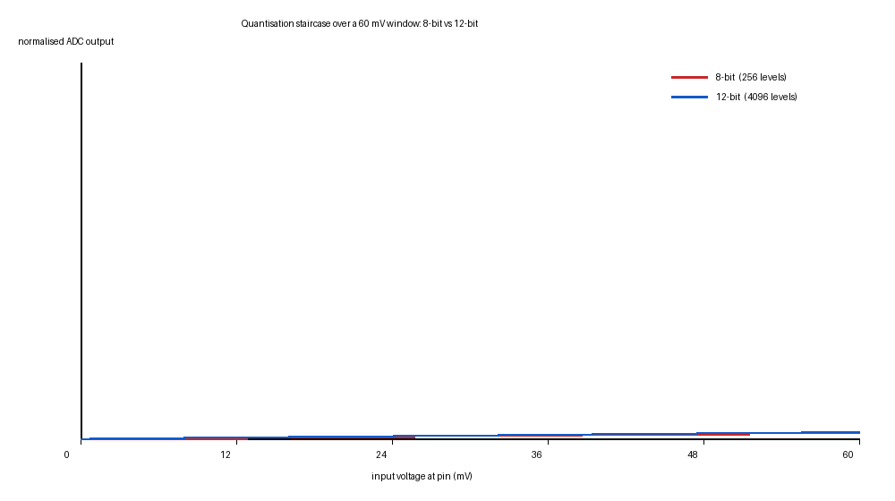

# Pre-Study Portfolio, Module 0

**Course:** Sensors and Actuators (Sensorik und Aktorik), HSBI
**LMS release:** 2026 · **Guide generated:** 2026-09-25 · **Source revision:** 31aa6ca
**Canonical source:** IoTempire Teaching repository, HSBI/GT Sensors and Actuators
**Portfolio file:** `pre-study/README.md`

This is my Module 0 entry. It follows the Pre-Study Guide section by section: the signal chain,
the Wokwi mini-exercise, the two datasheets, measurement and uncertainty, the actuators primer,
my project idea, and then the eight Guiding Questions. Everything below was done on a laptop
with a browser. No hardware and no paid account were needed.

### Time log

| Section | Guide's estimate | What I actually spent |
|---|---|---|
| 2. Wokwi mini-exercise | 60–90 min | 1 h 25 min |
| 3. Datasheet analysis | 45–60 min | 1 h 05 min |
| 4. Measurement & uncertainty | 45–60 min | 50 min |
| 5. Actuators primer | 30–45 min | 40 min |
| 6. Project idea | 30 min | 35 min |
| 7. Guiding Questions write-up | — | 1 h 10 min |
| **Total** | **3–6 h core** | **≈ 5 h 45 min** |

A note on the numbers, because I use a lot of them below. Three different kinds appear and I have
tried to keep them apart:

- **arithmetic** on published figures (for example `full-scale ÷ 2ⁿ` when working out step sizes),
- values **quoted from a datasheet**, always with the conditions that the datasheet attaches,
- values I **measured**, either off the Serial Monitor during the simulation or by analysing the
  screenshots afterwards.

Where a datasheet simply does not state something, I have written that it does not, rather than
guessing a plausible number. Two of those gaps turned out to matter for my project.

---

## 1. Sensors and Actuators: the big picture

### 1.1 The chain

Almost every sensor system follows the same chain. This is the version from the guide, redrawn
with the parts from our kit:

```
        physical quantity                (temperature, distance, light, current, force …)
                |
                v
        transducer (sensor)              VL53L0X ToF · MPR121 cap. touch · Hall · IMU
                |                        converts the quantity into an electrical effect
                v
        signal conditioning              amplifier · voltage divider · filter · reference
                |                        makes the signal big/clean enough for the ADC
                v
        ADC + MCU                        ESP32: sample -> filter -> calibrate -> integer code
                |
                v
        system                           local-first IoTempower + MQTT + Node-RED + dashboard
                |
                |  command
                |  (PWM / driver)
                v
        actuator                         servo · DC motor · relay · buzzer · LED / WS2812
                |                        acts back on the world
----------------+---------------------------------------------------------------
```

The loop closes: the dashboard shows the measured value, and the same node can be told to move
something. Sensor and actuator share one MCU and one power budget, which is the part that
actually causes trouble.

### 1.2 What each stage costs me

| Stage | What it does | What goes wrong here | Kit example |
|---|---|---|---|
| Physical quantity | the thing I actually care about | I measure a proxy, not the quantity | air temperature |
| Transducer | converts quantity → electrical effect | non-linear transfer function, drift, self-heating | NTC, strain gauge, photodiode |
| Signal conditioning | scales, filters, references | noise pickup, wrong gain, bad reference | divider, op-amp, RC filter |
| ADC + MCU | quantises and digitises | quantisation error, ADC non-linearity, aliasing | ESP32 SAR ADC, 12 bit |
| System | transports and presents the number | network loss, wrong units, silent staleness | IoTempower → MQTT → Node-RED |
| Actuator | acts on the world | not enough current, no driver, wrong torque | LED, servo, relay |

### 1.3 Three ideas I want to get right early

**A sensor never measures what I think it measures.** It measures some physical effect
(resistance, voltage, charge, light, time) that correlates with the quantity I actually want.
The work is in knowing that relationship, the transfer function. The VL53L0X does not measure
distance, it measures the flight time of infrared light and converts it.

**Every number carries uncertainty.** Resolution, accuracy, noise and calibration all limit what
I am allowed to claim. "23.4 °C" is a statement with conditions and an uncertainty attached, not
a fact about the world.

**Actuators are physical too.** A motor needs current and a driver. A single LED needs a
current-limiting resistor. A WS2812 strip needs a power budget, because dozens of LEDs at full
white draw far more current than any logic pin can supply. Logic pins command; they do not
power.

---

## 2. Required Mini-Exercise: Wokwi Simulation

### 2.1 What I built

A browser-based ESP32 simulation in [Wokwi](https://wokwi.com/) that closes the smallest possible
version of the chain: analog in, digital in between, analog out.

- a potentiometer on an ADC input pin, standing in for the physical quantity,
- the ESP32's SAR ADC turning it into an integer code,
- that code mapped onto an LED's PWM duty cycle, so turning the pot visibly changes brightness,
- and the same values printed to the Serial Monitor.

### 2.2 Wiring

Wokwi parts: `wokwi-potentiometer`, `wokwi-led`, `wokwi-resistor`, on board
`board-esp32-devkit-c-v4`.

| Part | Pin | ESP32 pin | Why |
|---|---|---|---|
| Potentiometer | VCC | `3V3` | ratiometric: the pot divides the same reference the ADC uses |
| Potentiometer | GND | `GND` | — |
| Potentiometer | SIG (wiper) | `GPIO 34` | ADC1 channel 6, and input-only, so there is no risk of an output conflict. ADC2 pins are unusable while Wi-Fi is on, which I should remember once the real kit arrives. |
| LED | anode | `GPIO 25` via 220 Ω | LEDC-capable output pin, so it can do PWM |
| LED | cathode | `GND` | — |

The potentiometer also carries a starting position in `diagram.json` (`"value": "960"`, on a
0–1023 scale). That detail matters more than it looks: it is what let me hold the *input*
constant across the three resolution runs in 2.4(b). Without it every run would have started at
zero and the comparison would have proved nothing. As 2.4(e) explains, that attribute sets the
ADC code directly, so it is a simulation convenience rather than a model of a real divider.

### 2.3 The sketch

The full listing that produced the captures is in
[Appendix A](#appendix-a-wokwi-sketch-listing) and in [`wokwi/sketch.ino`](wokwi/sketch.ino). The
two things I change between runs are `ADC_BITS` and `USE_COARSE_THRESHOLD`:

```cpp
const int  ADC_BITS = 12;              // 8, 10 or 12  <-- the variable I change
const bool USE_COARSE_THRESHOLD = false;
const int  COARSE_LEVELS = 4;          // deliberately coarse: 4 levels, not 256

void setup() {
  Serial.begin(115200);
  analogReadResolution(ADC_BITS);      // ESP32: 9..12 change the hardware resolution,
  analogSetAttenuation(ADC_11db);      // anything else is shifted in software
  pinMode(PIN_LED, OUTPUT);
  Serial.printf("ADC resolution %d bit -> codes 0..%d (%d discrete steps)\n",
                ADC_BITS, adcMax, adcMax + 1);   // the step count comes from the chip
}

void loop() {
  int raw = analogRead(PIN_POT);            // 0 .. adcMax
  int mv  = analogReadMilliVolts(PIN_POT);  // calibrated millivolts

  int brightness;
  if (USE_COARSE_THRESHOLD) {
    int bucket = (raw * COARSE_LEVELS) / (adcMax + 1);          // 0..3
    brightness = map(bucket, 0, COARSE_LEVELS - 1, 0, 255);
  } else {
    brightness = (int)((long)raw * 255L / adcMax);
  }
  analogWrite(PIN_LED, brightness);

  Serial.printf("raw=%4d/%4d  %4d mV  duty=%3d  %5.1f%%\n",
                raw, adcMax, mv, brightness, brightness * 100.0 / 255.0);
  delay(400);   // slow enough to read in the Serial Monitor
}
```

Having the sketch print its own step count is deliberate. It means the numbers I quote in GQ2
are the program's output, not something I worked out separately and hoped was right.

### 2.4 What I observed

**(a) The analog range is not continuous. It is a staircase.**

An n-bit converter can only produce 2ⁿ codes, so a smooth rotation of the pot comes out as
discrete steps. These figures are arithmetic on `full-scale ÷ 2ⁿ`:

| ADC resolution | Code range | Discrete levels (steps) | Step size, ideal 3.3 V span | Step size, documented 3.1 V span | Pot angle per step (300° pot) |
|---|---|---|---|---|---|
| 8-bit | 0 .. 255 | **256** | 12.891 mV | 12.109 mV | 1.172° |
| 10-bit | 0 .. 1023 | **1024** | 3.223 mV | 3.027 mV | 0.293° |
| 12-bit | 0 .. 4095 | **4096** | 0.806 mV | 0.757 mV | 0.073° |



*The same 60 mV of pot rotation seen by an 8-bit and a 12-bit converter. The 8-bit output can
only take five values in this window; the 12-bit output manages about seventy-five. That picture
is basically the whole idea of resolution.*

**(b) The code range really does change with the resolution setting.**

I did not want to just assert this, so I ran it. The potentiometer stayed at the same position
(`value: 960`) in all three runs, so the physical input was identical, and only `ADC_BITS`
changed:

| `ADC_BITS` | Serial Monitor reports | Steps |
|---|---|---|
| 12 | `raw=3843/4095` | 4096 |
| 10 | `raw= 960/1023` | 1024 |
| 8 | `raw= 240/ 255` | 256 |

3843 : 960 : 240 is 16 : 4 : 1, which is exactly 4096 : 1024 : 256 once the converter's rounding
is allowed for. Same voltage in, three different integer ranges out. Raw logs:
[12-bit](wokwi/evidence/12bit-pot960-serial.txt),
[10-bit](wokwi/evidence/10bit-pot960-serial.txt),
[8-bit](wokwi/evidence/8bit-pot960-serial.txt).

The pot's own scale is 0–1023 and the mapping is clean: pot 160 gives `raw=640`
(160/1023 × 4095 = 640.5) and pot 960 gives `raw=3843` (960/1023 × 4095 = 3843.0). So in the
simulator the code tracks the knob linearly. Section 2.4(e) explains why that is a warning
rather than a reassurance.

**(c) The millivolt reading is badly non-linear at the bottom of the range.**

`analogRead()` and `analogReadMilliVolts()` disagree with a naive linear model, and the
disagreement is worst in exactly the region the datasheet warned me about:

| raw code | `analogReadMilliVolts()` | linear model `raw/4095 × 3300 mV` | difference |
|---|---|---|---|
| 0 | **142 mV** | 0 mV | +142 mV |
| 640 | **681 mV** | 516 mV | +165 mV |
| 3843 | **3067 mV** | 3096 mV | −29 mV |

At raw code 0 the chip still reports 142 mV. That is the "measurable window starts at 150 mV"
effect from 2.4(d) showing up as a real offset, and it is a reminder that the calibrated
millivolt value comes out of a correction curve rather than a multiplication. I would not have
guessed the low-end error was that large.

**(d) Two ESP32 details that a naive reading of the API page misses.**

The first is `analogReadResolution()`. It accepts 1–16, but on the ESP32 only 9 to 12 actually
change the ADC hardware resolution; anything outside that is produced by shifting the 12-bit
result in software ([Arduino-ESP32 ADC docs](https://docs.espressif.com/projects/arduino-esp32/en/latest/api/adc.html)).
So my "8-bit" reading is really a 12-bit conversion with the bottom four bits thrown away. The
8-bit run shows this nicely: the raw code collapses from 3843 to 240 while the calibrated
millivolt value stays at 3066 mV. That is what software truncation of a 12-bit result looks
like, and it is not the same thing as an 8-bit converter.

The second is the input window. With the required `ADC_11db` attenuation the documented
measurable range is 150 mV to 3100 mV, not 0 to 3.3 V. Below roughly 150 mV there is no
specified measurement at all, and 150 mV is about 198 codes of a 12-bit scale. I have 4096
codes, but I am not entitled to claim the bottom 200 of them.

**(e) What the simulation does not model, which I found in its own documentation.**

Wokwi's potentiometer reference contains this sentence:

> "Wokwi does **not** support full analog simulation, so you will get the same results even if
> you don't connect the GND/VCC pins."

That one line changes how I read everything above. In the simulator the pot is a number, not a
resistive divider: the knob position *is* the ADC code, linearly, with no noise, no source
impedance, no loading and no wiring to get wrong. So the tidy 640 and 3843 I measured are
evidence about the converter's resolution and no evidence at all about my circuit. It is also
about the cleanest illustration I could ask for of the guide's warning that simulation never
replaces the multimeter.

**(f) The output really does follow the input.**

The exercise asks that turning the pot visibly change the output, so I checked rather than
squinted at it. Cropping the LED's exact bounding box out of each screenshot and averaging the
red channel gives a brightness ordering that matches the duty cycle ordering exactly:

| Run | duty | mean red in the LED box |
|---|---|---|
| LED driven LOW | 0 % | 70.0 |
| pot at 160 (12-bit) | 15.3 % | 80.1 |
| `analogWrite(25, 32)` | 12.5 % | 79.7 |
| pot at 960 (12-bit) | 93.7 % | 84.9 |
| pot at 960 (8-bit) | 94.1 % | 84.9 |
| pot at 960, coarse mode | 100 % | 85.6 |
| `analogWrite(25, 255)` | 100 % | 85.6 |
| `digitalWrite(25, HIGH)` | 100 % | 85.6 |

Two things convinced me this is not a coincidence. The ordering is strictly monotonic in duty
across eight independent runs, including a 12.5 % against 15.3 % pair that differ by only 0.4
grey levels in the right direction. And the three completely different code paths that all
produce 100 % duty (`analogWrite(255)`, `digitalWrite(HIGH)`, and the coarse-threshold bucket
sitting in its top bucket) land on the identical value 85.6. A 100 % duty cycle *is* a constant
high, so that is what should happen, and the fact that it does suggests `analogWrite` is really
reaching the LEDC peripheral rather than being quietly ignored.

**(g) Deliberately too coarse, and why the output jumps.**

With `COARSE_LEVELS = 4` the 4096 codes get folded into four buckets, so the LED has only four
brightnesses: 0 %, 33 %, 67 %, 100 %. Turning the pot then does nothing at all for a quarter of
its travel and jumps a whole step at the boundary. In my captured coarse run the pot sits at
960, inside the top bucket, so the output is pinned at `duty=255 (100.0%)`, which is the
brightness it would show anywhere in that top quarter. Nothing about the sensor got worse; I
threw the information away in software. That is the difference between a resolution choice and a
sensor limit, and it is the same thing that happens on a real machine when a badly chosen
threshold makes a light snap on instead of fading up.

### 2.5 Evidence

Five Wokwi runs. For each one I kept both the screenshot and the raw Serial Monitor text, so
every number quoted above can be checked against the log instead of taken on trust.

| Run | `ADC_BITS` | Pot | Screenshot | Serial log | Last line |
|---|---|---|---|---|---|
| 12-bit, pot ≈ 16 % | 12 | 160 | [png](wokwi/evidence/12bit-pot160.png) | [txt](wokwi/evidence/12bit-pot160-serial.txt) | `raw= 640/4095   681 mV  duty= 39   15.3%` |
| 12-bit, pot ≈ 94 % | 12 | 960 | [png](wokwi/evidence/12bit-pot960.png) | [txt](wokwi/evidence/12bit-pot960-serial.txt) | `raw=3843/4095  3067 mV  duty=239   93.7%` |
| 10-bit, pot ≈ 94 % | 10 | 960 | [png](wokwi/evidence/10bit-pot960.png) | [txt](wokwi/evidence/10bit-pot960-serial.txt) | `raw= 960/1023  3066 mV  duty=239   93.7%` |
| 8-bit, pot ≈ 94 % | 8 | 960 | [png](wokwi/evidence/8bit-pot960.png) | [txt](wokwi/evidence/8bit-pot960-serial.txt) | `raw= 240/ 255  3066 mV  duty=240   94.1%` |
| coarse threshold | 12 | 960 | [png](wokwi/evidence/12bit-coarse-pot960.png) | [txt](wokwi/evidence/12bit-coarse-pot960-serial.txt) | `raw=3843/4095  3067 mV  duty=255  100.0%` |

Cropped views of the circuit are in [`wokwi/evidence/crops/`](wokwi/evidence/crops/), and
[`wokwi/evidence/summary.json`](wokwi/evidence/summary.json) has the machine-readable summary of
all five.

A representative application log, from the 12-bit run with the boot ROM messages stripped out:

```
ADC resolution 12 bit -> codes 0..4095 (4096 discrete steps)
Potentiometer on GPIO34, LED on GPIO25
-----------------------------------------------
raw=3843/4095  3067 mV  duty=239   93.7%
raw=3843/4095  3067 mV  duty=239   93.7%
```

**(h) Extension I still want to try: an I²C device.**

Adding an OLED over the same two shared wires (SDA/SCL), which foreshadows Module 2. Both the
display and any other I²C device see every byte on the bus, and only the device whose address
matches responds. GQ5 is about what happens when two sensors want the same address.

### 2.6 What the simulation does not teach me

The simulation is for program flow and logic, and 2.4(e) is the proof: Wokwi's own docs say the
potentiometer behaves identically even with its supply and ground disconnected, because the knob
position is fed straight into the ADC as a number. No divider to load, no impedance, no noise,
no offset, no wiring to get wrong.

Real hardware adds everything this course is about: pin labels, voltage limits, loose wires,
noise, offset, self-heating, current draw. Everything I measured in the simulator is therefore
evidence about the converter's resolution and nothing about my circuit.

---

## 3. Read Like a Sensor Engineer

I read the **VL53L0X** (ST, time-of-flight distance) and the **MPR121** (NXP, capacitive touch)
datasheets against the four questions the guide asks, and for every performance number I wrote
down the condition attached to it. Sources are in [Appendix B](#appendix-b-sources).

### 3.1 How I read them

Before writing any number down I asked "at what conditions?" and where the datasheet did not
state one, I wrote "not stated" rather than filling the gap myself. That turned out to be the
most useful part of the exercise. Several things I expected to find are simply not in the
documents at all, and those gaps are design risks rather than footnotes.

### 3.2 VL53L0X, time-of-flight distance

**(1) What it measures, and how.**
Absolute distance to a target, by optical time-of-flight. A 940 nm infrared VCSEL emits short
light pulses, a SPAD array picks up the reflection, and an embedded MCU resolves the flight
time. For scale: light travels 1 m in about 3.34 ns, so a round trip to 30 cm takes roughly
2 ns. That is why this needs dedicated silicon rather than a GPIO.

**(2) Supply, interface, address.**

| Parameter | Value | Condition / note |
|---|---|---|
| Supply | **AVDD 2.6 – 3.5 V**, typ 2.8 V | abs max 3.6 V. There is no pin called "VDD" in the datasheet; it is AVDD, plus a separate AVDDVCSEL. |
| I/O rail | IOVDD 1.6 – 1.9 V (standard/1V8, default) *or* 2.6 – 3.5 V (2V8) | UM2039 Rev 2 folds standard mode into 1.6 – 3.5 V and removes the 2V8 function. |
| Current | HW standby 5 µA typ · SW standby 6 µA · inter-measurement 16 µA · **active ranging 19 mA typ** | @23 °C, 2.8 V, 33 ms default budget, including the VCSEL; ≤20 mA average at 10 Hz |
| Interface | **I²C, ≤400 kHz** | plus XSHUT (reset) and GPIO1 (interrupt) |
| Address | **0x52 (write) / 0x53 (read)** | 8-bit forms. The 7-bit form `0x29` is the usual way to write it but is not printed in the datasheet. I derived it, so I am marking it as derived rather than quoted. |
| Changeable? | **Yes**, in software (`VL53L0X_SetDeviceAddress`) | This is the escape hatch for two identical sensors on one bus: hold both in reset via XSHUT, release one at a time, re-address each. |

**(3) Range, resolution, accuracy, response time, temperature.**

*Range*, all at **33 ms timing budget, bare module, no cover glass, 23 °C, 2.8 V, full field of
view, ≥94 % detection rate**:

| Target | Indoor | Outdoor (≈5 klx daylight) |
|---|---|---|
| White 88 % | 200 cm+ typ (long-range profile); **120 cm minimum** | 80 cm typ / 60 cm min |
| Grey 17 % | 80 cm typ / 70 cm min | 50 cm typ / 40 cm min |

*Resolution.* The datasheet specifies no mm resolution and no minimum range or blind zone. The
API returns an integer `RangeMilliMeter`, so 1 mm is the register's LSB, not an accuracy claim.
Section 3.5 comes back to this, because it is a textbook trap.

*Accuracy*, quoted as σ, a percentage of distance, with the offset calibrated at 10 cm, 2.8 V,
23 °C, full field of view and ≥94 % detection:

| Target / place | σ at 33 ms | σ at 66 ms |
|---|---|---|
| White 88 %, 120 cm, indoor | **4 %** | 3 % |
| White 88 %, 60 cm, outdoor | 7 % | 6 % |
| Grey 17 %, 70 cm, indoor | 7 % | 6 % |
| Grey 17 %, 40 cm, outdoor | 12 % | 9 % |

*Offset drift:* across the supply range 2.6–3.5 V, ±10 mm typ / ±15 mm max; across
−20 to +70 °C, ±10 mm typ / ±30 mm max.

*Response time:* default timing budget 33 ms (23 ms measurement plus an 8 ms minimum
inter-measurement period), API minimum 20 ms. ST's profiles: default 30 ms, high accuracy 200 ms
(<±3 %), long range 33 ms (dark only), high speed 20 ms (±5 %).

*Temperature:* operating −20 to +70 °C, and the temperature (VHV, phase) calibration has to be
redone if the temperature moves more than 8 °C from where it was calibrated.

**(4) Conditions and limitations the datasheet warns about.**

**Reflectance matters.** The product page claims the range is "independent of target
reflectance", but the datasheet's own tables show both the maximum range and σ getting worse
going from white 88 % to grey 17 %. The datasheet wins, and 3.5 says more about this.

**Four distinct failure modes**, each with its own status flag: ambient infrared causes a *sigma*
failure, a weak return signal causes a *signal* failure, wraparound causes a *phase* failure, and
VCSEL faults cause a *hardware* failure. Worth reading in code rather than treating every bad
reading as "no target in front of me".

**Cover glass crosstalk.** The error is proportional to crosstalk over signal, and depends on the
glass type and the air gap, and it has to be calibrated out. No numeric air-gap dimension appears
in the datasheet or the API manual, so I would have to find an application note or measure it
myself.

**Field of view:** 25° system, with 25° emitter and 35° collector exclusion cones.

**Laser safety:** Class 1 (IEC 60825-1:2014, EN 50689:2021, 21 CFR 1040.10/1040.11). Do not
increase the power or try to focus the beam with optics.

**Not documented anywhere I looked:** minimum range or blind zone, warm-up time, self-heating.

### 3.3 MPR121, capacitive touch

**(1) What it measures, and how.**
The self-capacitance of each sensing pad to ground. A constant DC current charges the pad, and
the resulting voltage, sampled by a 10-bit ADC, is inversely proportional to the capacitance.
Bringing a finger near the pad adds parallel-plate capacitance (ΔC) and shifts that reading. The
chip keeps a baseline, a slow-filtered estimate of the background capacitance, and declares a
touch when `Baseline − FilteredData > threshold`. So the thing being measured is a capacitance
change, not "touch".

**(2) Supply, interface, address.**

| Parameter | Value | Condition / note |
|---|---|---|
| Supply | **VDD 1.71 – 3.6 V** | abs max −0.3 to +3.6 V |
| Regulator | internal regulator needs 2.0 – 3.6 V input; **VREG abs max 2.75 V** | tie VDD = VREG when the supply is ≤2.75 V so the regulator is bypassed, otherwise feed VDD only, with 0.1 µF on VREG |
| REXT | **75 kΩ, 1 %** | a wrong value raises OVCF and forces Stop Mode |
| Interface | **I²C slave, ≤400 kHz** | plus an active-low open-drain IRQ |
| Address | **ADDR pin selects** 7-bit: VSS→`0x5A`, VDD→`0x5B`, SDA→`0x5C`, SCL→`0x5D` | 8-bit pairs 0xB4/0xB5, 0xB6/0xB7, 0xB8/0xB9, 0xBA/0xBB. Four devices give 48 pads. |
| Library default | `Adafruit_MPR121`, `begin(0x5A)`, touch 12 / release 6 counts | |

**(3) Inputs, sensitivity, response time, temperature.**

*Inputs:* 12 electrodes (ELE0–11), eight of which double as GPIO/LED drivers, plus a 13th
*simulated* proximity electrode that sums ELE0–1, ELE0–3 or ELE0–11. All 13 channels are
independently configured and each reports its own status bit every scan. No primary source I
found states a numeric cap on simultaneous touches; the status registers simply report up to 12
electrode bits plus PROX. The documented multi-touch caveats are matrix ghost points,
multiplexed-button ambiguity, and palm or stuck-key calibration-out.

*Sensitivity:* roughly 10 pF to over 2000 pF, with resolution up to 0.01 pF. The fact sheet
instead says "1 pF to 2000 pF", which is an unresolved discrepancy I am flagging rather than
quietly picking one. Filtered data is 10-bit (0–1023); the baseline is also 10-bit but only its
8 MSBs are readable. Charge current CDC 0–63 µA in 1 µA steps; charge time CDT 0.5–32 µs.
Detection is a counts-versus-threshold comparison, with thresholds typically 0x04–0x10, and NXP
advises keeping the touch Δ above about 10 counts.

*Response time:* filtered data and status update every `ESI × SFI`, typically 16 ms × 4 = **64 ms**,
worst case **96 ms**. Debounce (0–7, meaning 1–8 consecutive detections) adds
`ESI × SFI × DT/DR`. At the slowest 128 ms sampling a touch has to last about a second to wake
the part.

*Current:* 29 µA typical running at 16 ms sampling with all 12 electrodes plus proximity, 3 µA in
Stop Mode, and a 1 mA peak during a measurement. At 1 ms sampling it rises to 393 µA.

*Temperature:* operating −40 to +85 °C. No temperature coefficient, drift or humidity figure is
specified at all. The datasheet deals with drift by mechanism rather than by spec: baseline
tracking with separate rising, falling and touched states (MHD/NHD/NCL/FDL) absorbs slow
environmental change, the fast rising filter allows recovery, the slow falling filter tolerates a
wet rag or a humid swing, and a touched-state timeout calibrates out stuck keys.

**(4) Conditions and limitations the datasheet warns about.**

The pad-to-overlay air gap has to be eliminated. Even a sub-millimetre gap can stop detection
entirely, and this looks like the number one build error.

Pad size goes with overlay thickness: about 3 mm minimum pad on 0.5 mm PET, about 7 mm on
2.0 mm PET. A 7 mm pad gives 40 Δcounts through 0.5 mm PET but only 11 through 2.0 mm, which is
right at NXP's advised floor. Keep plastic covers at or under 0.5 mm; a higher-dielectric cover
helps (glass K≈4 against plastic K≈2).

Ground fill steals the sensing field, so keep it clear or use a 40–50 % hatched fill. The pads
also act as EMI antennas, with proximity pads worst and a 40–20 % fill advised.

Proximity reaches about 2 cm for a palm or 12-key pad, up to 5 cm with large concentric pads.

There is a register-access trap: most configuration registers are writable only in Stop Mode
(except ECR 0x5E and the GPIO/LED block 0x73–0x7A), and auto-configuration re-runs on every
Stop→Run transition. There is also a start-up trap, where the baseline starts at 0 and ramps very
slowly, so NXP recommends preloading it (CL = 10) from the first sample to avoid a dead period
with no touches after entering Run Mode. That is the sort of thing that looks like a broken board
and turns out to be a register.

Finally, OOR (out-of-range) means a short to ground, to a rail, or to an adjacent pad.

### 3.4 Side by side

| | VL53L0X | MPR121 |
|---|---|---|
| Quantity → principle | distance → optical ToF @940 nm (VCSEL + SPAD) | touch → pad self-capacitance, 10-bit CDC |
| Supply | AVDD 2.6–3.5 V (typ 2.8 V), separate IOVDD | VDD 1.71–3.6 V, internal regulator, REXT 75 kΩ |
| Interface | I²C ≤400 kHz | I²C ≤400 kHz + IRQ |
| Address | 0x52/0x53 (8-bit), changeable in software | 0x5A/0x5B/0x5C/0x5D via ADDR pin |
| "Resolution" figure | 1 mm register LSB (not specified as a spec) | 0.01 pF (disputed against the fact sheet) |
| Accuracy figure | **σ = 4 % of distance** (white 88 %, 120 cm, indoor, 33 ms) | no accuracy spec; threshold 4–16 counts |
| Response time | 33 ms default budget (20–200 ms profiles) | 64 ms typ, 96 ms worst case |
| Temperature | −20 to +70 °C; recalibrate if ΔT > 8 °C | −40 to +85 °C; **no drift spec published** |
| Current | 19 mA active, 5 µA standby | 29 µA running, 3 µA stop |
| Biggest gotcha | cover-glass crosstalk and reflectance dependence | air gap under the overlay, baseline start-up |

### 3.5 What reading them critically actually taught me

**The brochure and the datasheet disagree.** The VL53L0X product page says the range is
"independent of target reflectance". The datasheet's own tables say a grey-17 % target in
daylight reaches 40–50 cm where a white-88 % target reaches 60–80 cm, and σ roughly doubles.
A measurement document is not marketing material, and when the two disagree the table with
conditions attached is the one I design against.

**Resolution is not accuracy, twice over.** The VL53L0X hands me millimetres but is only good to
4 % of distance, which is 48 mm at 1.2 m. The MPR121 resolves 0.01 pF, but whether a touch gets
detected depends on whether the capacitance change beats a threshold of a few counts. In both
cases the fine number is the convenient one and the coarse number is the true one, which is the
same trap as Section 4.3.

**The most useful thing I found was what is missing.** Neither datasheet states the numbers I
would need to design the mechanical part with any confidence: no minimum range or blind zone and
no warm-up time for the VL53L0X, no numeric cover-glass air gap, and no temperature or humidity
drift coefficient and no numeric simultaneous-touch limit for the MPR121. Those are not details
to skim past. They are things I either have to track down in an application note or measure on
the bench, and I have added them to my project plan as open questions.

---

## 4. Measurement and Uncertainty Basics

### 4.1 True value, error, uncertainty

The **true value** is what a perfect measurement would give. In practice it is unknowable, which
is why the discipline is about bounding it rather than hitting it.

**Measurement error** is `measured value − true value`. It has a sign and a magnitude, and in a
real measurement it is unknown. If I knew it, I would subtract it.

**Measurement uncertainty** is not "the error". It is a quantified interval attached to the
result, describing the dispersion of values I may reasonably attribute to the measurand. It is an
admission of what I do not know, written as a number.

Here is a worked illustration, not a bench reading, using our own sensor. A VL53L0X reports
`1204 mm` to a white target and a steel tape says `1200 mm`. The error is `+4 mm`. But the
datasheet quotes accuracy as a standard deviation expressed as a percentage of distance, and only
under stated conditions: white 88 % reflectance, 120 cm, indoors, 33 ms timing budget, offset
calibrated at 10 cm, 2.8 V, 23 °C, full field of view, ≥94 % detection rate. There it is 4 %.
Four percent of 1200 mm is **±48 mm at 1σ**, and a proper statement would expand that by k = 2 to
about ±96 mm for roughly 95 % coverage. So the 4 mm I called "the error" is twelve times smaller
than the uncertainty I am entitled to claim.

That is the point of keeping the three terms apart. In a real measurement both the error and the
true value are unknown, so the only one of the three I can actually put a number on is the
uncertainty, and it is what makes the reading usable. A bare "1204 mm" is not a measurement, it
is just a number.

For contrast: the ESP32's ADC is precise but not accurate, because its offset is repeatable but
not zero. Averaging a million samples will not remove it. Section 4.4 explains why.

### 4.2 Accuracy against precision

The classic picture is a target with four shots in it. Accuracy is how close the group is to the
bullseye; precision is how tight the group is.

| | **Precise** | **Not precise** |
|---|---|---|
| **Accurate** | tight cluster on the bullseye, which is what you want | scattered around the bullseye, averaging out to it |
| **Not accurate** | tight cluster, but off to one side, so a repeatable bias | scattered and off-centre, the worst case |

Two examples from the kit:

*Accurate but not precise:* an averaged VL53L0X reading taken against a moving hand. Individual
samples scatter by centimetres, which is random error and no precision, but the mean of 50
samples sits on the true distance.

*Precise but not accurate:* the ADC offset above. Readings of a fixed 1.000 V reference all come
back as `1.043 V ± 1 mV`. Beautifully repeatable and systematically wrong. Averaging cannot fix
it, only calibration can.

This is the case people mix up. A tight group off the bullseye *feels* trustworthy precisely
because it repeats, and repeatability is the only one of the two properties you can see without
a reference.

### 4.3 Resolution against accuracy

**Resolution** is the size of one step, `full-scale ÷ 2ⁿ`. **Accuracy** is how close the reported
code is to the truth. They are independent, and resolution is the cheaper of the two. A converter
can hand me 4096 codes and still be wrong by the equivalent of 20 of them.

Concretely, from Section 2.4(d), where one of the four points is now measured rather than quoted:

1. **Dead zone.** With `ADC_11db` the specified measurable window is 150–3100 mV, so the bottom
   150 mV is about 198 codes of a 12-bit scale carrying no guarantee. I have 4096 codes but only
   about 95 % of the span is specified. Measured in the simulation: at raw code 0 the chip
   reports 142 mV rather than 0 V, and at raw 640 it reports 681 mV where a linear 3.3 V model
   predicts 516 mV. The error sits at the bottom of the range, exactly where the datasheet stops
   making promises, and it is about 200 LSBs wide.
2. **Non-linearity.** A real successive-approximation ADC's transfer curve is not a perfect
   staircase. Integral non-linearity means the *position* of a step can be off by several LSBs
   even when the *width* of the step is one LSB. Finer steps do not repair a bent staircase, and
   the low-end error above is that non-linearity made visible.
3. **The sensor in front is usually worse.** If the transducer's own error is ±3 %, then the
   ADC's 12 bits are a rounding detail. The weakest link dominates and it is almost never the
   ADC's resolution.
4. **Noise.** Real silicon adds noise, and if that noise is several LSBs peak-to-peak the bottom
   bits of a 12-bit reading are dithering randomly, so the effective number of bits is lower than
   12. That is the ENOB idea, and averaging can buy some of it back. The simulator adds no noise
   at all, which is worth remembering: my five runs returned bit-identical codes every time.

So "12-bit" tells me the finest distinction the converter can theoretically draw and nothing
about whether that distinction means anything. Resolution is a property of the instrument;
accuracy is a property of the measurement, including its conditions.

### 4.4 Systematic against random error

| | Systematic error | Random error |
|---|---|---|
| Behaviour | same sign and roughly the same size every time, so repeatable | varies in sign and size from sample to sample |
| Sources | offset, gain error, non-linearity, a wrong reference, warm-up drift, a mounting bias | thermal noise, shot noise, EMI, mechanical vibration, ADC jitter |
| Detected by | comparing against a **reference**, or swapping in a known standard | **repeating** the measurement and looking at the spread |
| Reduced by | **calibration**, meaning offset and gain correction and the datasheet's own compensation | **averaging**, where the mean's standard error falls as σ/√N |

Calibration addresses the systematic part, averaging addresses the random part, and they are not
interchangeable:

- Averaging 1000 samples of a biased reading gives back the same bias with a smaller error bar. I
  get a confident wrong answer. This is exactly why the ESP32 has a documented calibration
  procedure and why `analogReadMilliVolts()` returns a calibrated value while `analogRead()` is
  explicitly described as non-calibrated.
- Calibrating does nothing about noise. A perfectly offset-corrected sensor still scatters.
- Averaging has costs too. It takes time, it assumes the quantity is not changing during the
  window, and it only reduces uncorrelated noise by √N, so halving the noise needs four times the
  samples.

In our kit this shows up as the MPR121's automatic baseline tracking being a systematic-error
mechanism, since it slowly re-zeros environmental capacitance drift, while the moving-average
filter in my `loop()` is a random-error mechanism.

### 4.5 Sampling and quantisation

The **Nyquist condition** says that to reconstruct a signal without losing information the
sampling frequency has to be at least twice the highest frequency present, `f_s ≥ 2·f_max`. Half
the sampling rate is the Nyquist frequency. If the signal contains energy above it, that energy
does not disappear; it **aliases**, folding down and appearing as a lower frequency that was
never there. Aliasing is worse than noise because averaging cannot touch it. An aliased component
looks like a real signal, and no amount of filtering afterwards removes it. The cure is an analog
anti-aliasing filter before the ADC, which is precisely the "filter" stage in the Section 1
chain.

For our kit: reading the ADC in `loop()` with a `delay(400)` samples at a couple of hertz.
Anything faster in the signal, such as mains hum at 50 Hz or PWM switching noise from the LED
driver, aliases straight into my readings as a slow wobble that looks like the sensor drifting.
That is a real trap, and it is part of why the supply and the LED should not share a careless
ground.

**Quantisation error.** Rounding to the nearest code means the error is at most ±½ LSB, and for a
signal spanning many codes it behaves like uniform random noise. Its RMS value is `LSB/√12`,
which gives the familiar

```
SNR_ideal ≈ 6.02 · n + 1.76   dB      (n = number of bits)
```

so 8 bit is about 50 dB, 10 bit about 62 dB, and 12 bit about 74 dB. Each extra bit buys roughly
6 dB.

The interesting failure is what quantisation does to a **small** signal. If the whole swing is
smaller than one LSB the converter cannot represent it at all: the output sits on one or two
codes and flicks between them. A slow gentle change becomes a square wave, and a ripple of a
fraction of a code, invisible in a full-scale signal, is now the entire output. The SNR formula
above stops applying because it assumed a full-scale signal. This is why a small signal has to be
amplified before the ADC rather than after, which is what the "signal conditioning" stage is for.
And when a signal sits exactly on a code boundary, tiny noise makes it chatter between two codes,
so adding a little deliberate noise (dither) actually improves the average resolution. That one
still feels backwards to me, but the maths is solid.

Two ways to do better than plain rounding, both relevant to my project: **oversampling and
averaging**, where averaging 4ⁿ samples buys n extra effective bits at the cost of bandwidth, and
**delta-sigma conversion**, where a 1-bit comparator oversampled enormously plus a digital filter
beats a naive 12-bit SAR converter for slow signals. That is why load-cell front-ends like the
HX711 are 24-bit.

---

## 5. Actuators Primer

### 5.1 PWM, duty cycle, dimming and servo angle

**PWM** switches a digital output fully on and off at a fixed frequency and varies the duty
cycle, which is the fraction of each period spent high. It works because most actuators respond
to the average over a time much longer than one period, while the switch itself stays in its two
efficient states and dissipates almost nothing.

**Dimming an LED:** at 1 kHz the eye integrates the pulses and sees brightness proportional to
duty. 0 % is off, 50 % is half, 100 % is full. The alternative, reducing the voltage, wastes the
difference as heat in a resistor and shifts the LED's colour. PWM keeps the current at the LED's
rated value on every pulse.

**Setting a servo angle:** a hobby servo does not use duty cycle the same way. It uses the width
of a single pulse in a roughly 50 Hz frame, nominally 1.0 ms for one end, 1.5 ms for centre and
2.0 ms for the other end, with many servos accepting 0.5–2.5 ms for a wider range. It is the
absolute pulse width that carries the angle, which is why a servo library is not the same thing
as `analogWrite`.

For the kit: ESP32 `analogWrite()` gives an 8-bit duty (0–255) through the LEDC peripheral, which
is plenty for dimming. WS2812 strips do not use PWM at all, which is 5.3.

### 5.2 Why a plain LED needs a current-limiting resistor

An LED is a diode. Above its forward voltage `V_f` the current rises exponentially with voltage,
and there is no meaningful internal resistance to limit it, so the current is set by the rest of
the circuit:

```
R = (V_supply − V_f) / I_target
```

For a red LED (`V_f ≈ 2.0 V`) on 5 V at 10 mA: `R = (5.0 − 2.0) / 0.010 = 300 Ω`, so the standard
330 Ω. On a 3.3 V pin with a blue LED (`V_f ≈ 3.2 V`) there is almost no headroom left, which is
why blue LEDs are awkward on 3.3 V logic.

Without a resistor, or with too much current, the LED draws whatever the source can give, which
is hundreds of milliamps, and destroys itself. Two failure modes matter:

1. **Thermal runaway.** More current makes the junction hotter, a hotter junction has a lower
   `V_f`, and a lower `V_f` allows more current. It runs away until the bond wire or the die
   fails, usually within milliseconds.
2. **It takes the microcontroller with it.** An ESP32 GPIO pin is not a power supply. Its
   absolute maximum is in the tens of milliamps and the recommended continuous current is lower
   still. Driving an LED straight from a pin, or shorting one while it is high, can exceed the
   pin's rating and damage the pin or the chip. The LED is not the only casualty.

A pleasant exception: WS2812 addressable LEDs need no external resistor, because each one has an
integrated constant-current driver on the die. That is part of what the extra cost buys.

### 5.3 Addressable LEDs (WS2812 / NeoPixel)

A plain RGB LED is one light with three separately wired dies, either common anode or common
cathode, needing three current-limiting resistors and three PWM pins, and every LED connected to
those pins shows the same colour at the same time. There is no addressing, just three shared
wires.

A WS2812 is different in kind, because each LED contains its own driver IC. DATA is daisy-chained
from one LED to the next, and each LED consumes the first 24 bits that reach it (8 bits each of
G, R and B), latches them, and forwards the rest down the line. That lets a single data pin
address hundreds of LEDs individually over a roughly 800 kHz single-wire protocol, and colour,
brightness and animation become pure software. The cost is a strict timing protocol, which is why
it works on an ESP32 with an RMT or LED driver but not reliably with `digitalWrite` in a busy
loop, plus sensitivity to the 3.3 V versus 5 V logic level on the data line.

**Why the strip needs a serious power budget.** Current scales with the number of LEDs and what
they are showing. At full white each WS2812 draws up to about 60 mA, which is three channels at
roughly 20 mA each. GQ7 does the arithmetic for a 30-LED strip and gets 1.8 A, which is a
different order of magnitude from a GPIO pin's few tens of milliamps. The practical rules that
fall out of it:

- Size the 5 V supply for the worst case, meaning all white, plus margin. Not the average colour.
- Inject power at both ends of long strips, because the copper traces themselves drop voltage and
  the far end visibly reddens at high brightness.
- Put a large electrolytic capacitor, around 1000 µF, across the strip's 5 V and GND to absorb
  the inrush at power-up, and a small series resistor of about 300–500 Ω in the data line.
- Never power the strip from the microcontroller's 5 V pin. Give the strip its own supply and
  connect the grounds together so the data signal has a common reference.
- Watch the logic level: at a 5 V supply a WS2812 wants about 0.7·VDD ≈ 3.5 V for a logic high,
  and the ESP32's 3.3 V is marginal. A level shifter is the standard fix.

### 5.4 Servo against brushed DC against stepper

| | Hobby servo | Brushed DC motor | Stepper motor |
|---|---|---|---|
| **What it is good at** | absolute positioning over a limited angle, and holding a position | raw speed and torque per euro, simple, spins continuously | precise, repeatable open-loop positioning and speed control |
| **Closed loop?** | yes: gearbox, potentiometer and internal controller | no, speed depends on load and voltage | no, but step counting is exact enough for most jobs |
| **Electronics needed** | none beyond a PWM-capable pin, since power comes from the supply | an **H-bridge** to reverse direction, plus a driver for anything but the smallest motor | a **stepper driver** such as A4988 or DRV8825 to sequence the coils |
| **Torque at low speed** | high, through the internal gearbox, and it can hold there | highest at stall, but it cannot hold there long without overheating | high, and it holds without gearing at low speeds, at the cost of full coil current |
| **Holding position** | yes, with modest current | no, it coasts | yes, but it burns full coil current and gets hot |
| **Control complexity** | low: one pulse train, angle is the pulse width | medium: direction, enable and PWM, no feedback | medium to high: step/dir pulses, microstepping, acceleration ramps, homing |
| **Typical use here** | latch, flap, pan-tilt, arm | wheels, pumps, fans | 3D-printer axes, precise linear motion |

A standard servo covers roughly 180°, or comes as a continuous-rotation variant with no position
control. Multi-turn absolute motion is the one thing a stepper does that a servo cannot.

### 5.5 Why motors and relays need a driver

A GPIO pin is a signal, not a supply. Three separate reasons force a driver stage in between:

1. **Current.** An ESP32 pin sources a few tens of milliamps at best. A small DC motor draws
   hundreds of milliamps running and several amps when stalled, and a stalled motor is a normal
   event rather than a fault. A relay coil is 50–100 mA, already past a comfortable pin current.
   A driver, whether a BJT, a MOSFET, an H-bridge or a driver IC, lets a small signal control a
   large current.
2. **Inductive kickback.** A motor winding or relay coil is an inductor, and interrupting its
   current produces a large reverse voltage spike, `V = −L·di/dt`, potentially hundreds of volts,
   which will destroy the switching device and the MCU if that device is a pin. The fix is a
   flyback diode across the coil, or an H-bridge or driver IC with one built in. This is the
   single most common way beginners kill a board with a relay.
3. **Voltage and isolation.** The motor or relay may run at 12 V or 24 V, or switch mains. Driver
   ICs and opto-isolators separate the logic domain from the power domain so a fault on the load
   side does not become a fault on the MCU side. Anything mains-adjacent has to be isolated and
   treated with real care.

The shape of the answer: gate the load with a logic-level N-MOSFET for on/off, an H-bridge or
motor driver IC when direction matters, a relay or solid-state relay for mains or isolated
switching, and a dedicated driver for servos and steppers. Always with a flyback path for
anything inductive, and a separate supply with a common ground.

---

## 6. Prepare Your Project Idea

### Project abstract

*Working title: **Bench Beacon**, an occupancy indicator for shared lab benches.*

In our labs and study rooms an occupied workspace looks exactly like a free one unless you walk
over and look. I want a small screenless indicator that sits on the bench edge and lets anyone in
the doorway see at a glance whether the place is free, claimed, or in use, and that reports the
same state into the course's local-first IoTempower + MQTT + Node-RED dashboard so the whole
floor can be seen from one page. A VL53L0X time-of-flight sensor watches the seat for a person,
and a capacitive touch pad lets the occupant claim or release the bench explicitly, which is the
ground truth a distance sensor on its own cannot supply. A short WS2812 strip along the bench edge
shows green, amber or red, animating on state changes so the transition is noticed from across
the room. Everything runs on one ESP32 node on the existing broker, with no cloud account and no
phone app. The interesting engineering is not the code but the conditions: the ToF reading
depends on the target's reflectance and on ambient light, the strip needs a real power budget
(1.8 A for 30 LEDs at full white), and the touch pad has to survive being ignored for hours. I
expect the fusion rule, "touch wins over distance", to need tuning once real people use it.

This is a first direction rather than a commitment.

### Why this one

The announcement lists several directions. I picked this one because it uses both sensors I
analysed in Section 3, so the datasheet work feeds straight into the design, and because its hard
actuator constraint, the strip's current and the 3.3 V data-level question, is exactly the "logic
pins command, they do not power" lesson in a form I can measure.

---

## 7. Guiding Questions

### GQ1. The chain, for one device I own

**Device: a digital bathroom scale.** It is a mass sensor with no actuator, which is itself worth
noting: the guide's chain includes a command path that a scale simply does not have.

| Stage | What it is here | Notes |
|---|---|---|
| Physical quantity | body mass | the quantity I care about |
| Transducer | four strain-gauge load cells in a **Wheatstone bridge** | the proxy is strain, meaning mechanical deformation sensed as a tiny resistance change. Mass is inferred through gravity. |
| Signal conditioning | bridge excitation, an instrumentation amplifier, and an anti-alias/low-pass filter | the bridge output is only a few millivolts at full scale, far below one ADC step, so it has to be amplified before the converter |
| ADC + MCU | a 24-bit delta-sigma front-end (the classic part here is the HX711), then the MCU | 24-bit and heavily oversampled because the signal is slow. The MCU tares, averages and converts to kg. |
| System | the LCD, plus a Bluetooth link to a phone app that logs the trend | this is where the number actually reaches a human |

**A second, shorter example: a smartphone.** Accelerometer and gyroscope (MEMS capacitive proof
mass) → on-chip conditioning and anti-aliasing → 16-bit ADC inside the sensor package → sensor hub
or SoC → the app or the operating system. Phones are a useful reminder that the "system" stage is
often inside the same chip.

### GQ2. Wokwi observation: how many discrete steps?

At the 12-bit default, **4096 steps**, covering codes 0 to 4095. After changing the resolution to
8-bit, **256 steps**, covering codes 0 to 255. For completeness, 10-bit gives 1024. The ratio is
16×, which is exactly 2¹²⁻⁸.

I did not want to just assert that, so I ran it. Three simulations with the potentiometer parked
at the same position (`value: 960`), changing only `ADC_BITS`. Same physical input, three
different integer outputs:

| `ADC_BITS` | Serial Monitor | Steps reported by the sketch |
|---|---|---|
| 12 | `raw=3843/4095` | 4096 |
| 10 | `raw= 960/1023` | 1024 |
| 8 | `raw= 240/ 255` | 256 |

3843 : 960 : 240 = 16 : 4 : 1 = 4096 : 1024 : 256. Logs:
[12-bit](wokwi/evidence/12bit-pot960-serial.txt),
[10-bit](wokwi/evidence/10bit-pot960-serial.txt),
[8-bit](wokwi/evidence/8bit-pot960-serial.txt).

**So what changed, resolution, accuracy, or both? Resolution only.** Three reasons:

1. The step size changed from 0.806 mV to 12.891 mV on an ideal 3.3 V span. That is a pure
   quantisation effect, a statement about the spacing of codes, which is resolution.
2. Accuracy is about where the codes sit relative to the truth, and the conversion itself did not
   get worse. The ESP32 documentation says that on this chip only 9 to 12 bits change the
   hardware resolution and other values are produced by shifting the 12-bit result, and my own
   8-bit run shows exactly that: the raw code collapses from 3843 to 240 while the calibrated
   millivolt reading stays at 3066 mV. The underlying measurement, with all its offset,
   non-linearity and noise, is identical. I did not degrade the converter, I rounded its answer.
3. Coarse quantisation actually hides error rather than adding it. A 12.9 mV step is much larger
   than the converter's real error, so at 8-bit the last digits stop flickering and the reading
   looks rock-steady while the underlying error is unchanged. That flicker was information about
   the error, not a defect.

There is a fourth piece of evidence from the same runs. At `raw = 0` the chip still reports
142 mV rather than 0 V (Section 2.4(c)). That is the converter's own error, and it is identical at
every resolution setting, which is precisely why changing the resolution cannot change the
accuracy.

So more bits buys finer distinctions, not a truer answer. The coarse-threshold run in 2.4(g) makes
the same point from the other direction: the same 4096-step data folded into four buckets gave a
visibly worse control result without any change in sensor accuracy.

### GQ3. Datasheet: interface, address, accuracy with conditions

**Sensor: VL53L0X.** Full analysis in [Section 3.2](#32-vl53l0x-time-of-flight-distance).

**Interface:** I²C, clock up to 400 kHz, plus two extra pins, `XSHUT` for hardware reset and
`GPIO1` for interrupt. Not SPI, not analog, not PWM. The distance is read as a register value
from the chip's own embedded MCU.

**Address:** default `0x52` write and `0x53` read, which are the 8-bit forms used on the wire.
Most libraries write this as `0x29` in 7-bit notation, but I want to be careful about provenance:
the 7-bit form is a convention I derived, it is not printed in the datasheet. The address is
changeable in software through `VL53L0X_SetDeviceAddress`.

**Stated accuracy, with its conditions:** the datasheet quotes accuracy as a standard deviation σ
expressed as a percentage of the measured distance, and it is only valid with the offset
calibrated at 10 cm, at 2.8 V, 23 °C, over the full field of view, with a detection rate of at
least 94 %:

> **σ = 4 % of distance** for a **white 88 % reflectance** target at **120 cm, indoors**, using
> the **33 ms** timing budget.

As a number I can actually use, at 1.2 m that is ±48 mm at 1σ, or about ±96 mm for roughly 95 %
coverage.

**The conditions are the whole answer**, because changing any one of them changes the result:

| If I change… | …then σ becomes |
|---|---|
| timing budget 33 ms → 66 ms | 4 % → **3 %**, which is the σ/√N averaging law from Section 4.4 |
| target white 88 % → grey 17 %, at 70 cm indoors | **7 %** |
| target white 88 % → grey 17 %, at 40 cm **outdoors** | **12 %** |

So the same sensor is a 3 % instrument or a 12 % instrument depending on what I point it at, how
much daylight is around, and how long I let it measure. Two further conditions are not accuracy
figures but still bound the answer: the offset drifts ±10 mm typical and ±30 mm maximum over
−20 to +70 °C, and the temperature calibration has to be redone if the temperature moves more than
8 °C. Saying "the VL53L0X is accurate to a few millimetres", which its 1 mm output resolution
invites, would be wrong by an order of magnitude.

For contrast, the MPR121 has no accuracy spec at all, only a detection threshold, typically
0x04–0x10 counts with NXP advising a touch Δ above about 10 counts. For a touch sensor "accuracy"
is not a meaningful single number; the datasheet specifies sensitivity conditions instead, namely
pad size, overlay thickness and air gap. Knowing which of the two kinds of specification I am
reading is part of the skill.

### GQ4. Accuracy against precision, two everyday examples

**Precise but not accurate: a cheap bathroom scale that is consistently 1.8 kg heavy.** Stand on
it five times and it returns 71.2, 71.2, 71.3, 71.2, 71.2 kg. Superb precision, repeatable to
100 g. But a calibrated reference says the true mass is 69.4 kg, so every reading is
systematically wrong by +1.8 kg. The scale is trustworthy-looking because it repeats, and wrong
because it is offset. A tare adjustment is the calibration that fixes it, and averaging a thousand
readings would only have made me more confident in a wrong number.

**Accurate but not precise: a cheap kitchen scale weighing a 500 g bag of flour.** Readings
scatter, say 494, 507, 498, 511 and 490 g, around a true 500 g, and their mean is exactly 500 g.
No single reading can be trusted to better than about ±10 g, but the average lands on the truth
and there is no systematic offset. Averaging 25 readings cuts the spread by √25 = 5×, to roughly
±2 g.

Put together, the practical rule is: **precision tells me how much to average, accuracy tells me
whether averaging helps at all.**

### GQ5. I²C anticipation

**The problem.** I²C is a bus: one pair of wires, SCL for clock and SDA for data, shared by every
device, with pull-up resistors and open-drain drivers so any device can pull a line low without
shorting another. That sharing is the whole point and also the whole problem. Every device
physically receives every byte that is sent, and there is no separate wire per sensor. If two
devices both answer when the master addresses one of them, both drive SDA at the same time and
what appears on the wire is the logical AND of two different answers, which is garbled and
undetectable by the master. Nothing "collides" in any way the master can notice electrically.

**What the address is for.** The address is what makes a shared medium work at all. The master
begins every transaction with a start condition followed by an address byte, and only the device
whose address matches takes part in the rest of the transaction, while everybody else stays silent
until the next start condition. The address is not a security feature or a routing label; it is
the arbitration mechanism that turns one wire pair into many independent conversations, plus a
read/write bit. That is why a device's address is one of the first things to check in a datasheet,
and why the guide's advice to scan the bus and find out where your sensors live before trusting a
library is real advice: the library may be talking confidently to the wrong chip.

**What I expect to hit in Module 2.** Many parts have fixed addresses. The VL53L0X comes up at
`0x52`/`0x53` in 8-bit form, the familiar `0x29` in 7-bit notation, so two identical sensors
conflict by default. The usual escapes are an address-select pin (the MPR121 offers four
addresses through its ADDR pin, 0x5A through 0x5D), a re-programmable address register as the
VL53L0X documents, or a bus multiplexer such as the TCA9548A that gives each sensor its own
switched branch. I also need to remember that the bus runs at 3.3 V on the ESP32, that pull-ups
are needed, and that every extra device adds capacitance the pull-ups have to charge, which is why
the bus has both a maximum speed and a maximum total capacitance. I will answer this properly in
Module 2, from the bus itself.

### GQ6. Actuator choice for a small door latch moved once every few minutes

**I would use a hobby servo.**

| Criterion | Why the servo wins |
|---|---|
| **Torque** | a geared servo multiplies the motor's torque through its gearbox and holds a defined position, so a few kg·cm at the shaft is available continuously while the latch is held. A bare brushed DC motor of the same size makes its greatest torque only when stalled and falls off as speed rises, and holding a latch means holding it stalled, which is exactly the condition that overheats an ungeared motor. |
| **Simple control** | one PWM signal, no driver board, no limit switches, no homing. The servo's internal potentiometer closes the loop, so "go to 30°" is one line of code and I can position the latch anywhere rather than only in two places. |
| **Power** | it moves for about 200 ms every few minutes and then only holds. If the latch is balanced so the servo is not fighting a spring, that holding current is small and the average is tiny. A stepper, by contrast, burns full coil current continuously just to hold position, which is the wrong trade for something that almost never moves. |

**What I would not use, and why:**

- **A bare brushed DC motor.** It spins and has no idea where it is. To stop at a defined latch
  position I would need limit switches or an encoder, plus an H-bridge to reverse it. More parts,
  more code, and worse behaviour than the servo for the same job.
- **A stepper motor.** Genuinely precise and repeatable, and it would work, but it needs a driver
  IC, step and direction timing, possibly acceleration ramps and a homing routine, and it holds
  position by burning current indefinitely. That is a lot of complexity and standby power to move
  a latch a few degrees every few minutes. Precise positioning is the one thing it does well that
  I do not need here.
- **A solenoid** is the honest runner-up. On a pure two-position latch it is arguably the simplest
  device of all: energise and it pulls, de-energise and a spring returns it. I rejected it because
  it is strictly bang-bang with no intermediate position and no soft close, it draws a large
  inrush current, and it still needs a driver transistor and a flyback diode, so it is not
  actually simpler than a servo once the electronics are counted.

One thing I would check on the bench: a servo buzzes and draws hold current while loaded, and a
standard servo only covers about 180°, so the latch geometry has to fit inside that travel.

### GQ7. LED power math for a 30-LED WS2812 strip

```
per LED at full white    ≈ 60 mA   (3 channels × ~20 mA)
30 LEDs                  = 30 × 60 mA = 1800 mA = 1.8 A
power                    = 5 V × 1.8 A = 9.0 W
```

So the 5 V supply has to provide **1.8 A**, and in practice more. I would specify a 5 V / 3 A
(15 W) supply. The 1.8 A figure is the worst realistic case, since it assumes every LED at full
white simultaneously, which an animation will hit, and it excludes everything else. On top of it I
want headroom for the ESP32 node itself (tens to a few hundred milliamps, more while Wi-Fi
transmits), for supply tolerance, and for the fact that a cheap supply's rating is often
optimistic. Under-sizing a supply shows up as brownouts and random resets, which look like
software bugs and are not.

**Why the microcontroller's 5 V pin cannot supply this.** Several independent reasons, any one of
which is enough on its own:

1. **The pin is not a supply.** On a dev board the `5V` or `VIN` pin is a pass-through from the
   USB connector or the regulator input, so its current limit is the source's limit.
2. **USB gives 500 mA.** A standard USB 2.0 port supplies 0.5 A at 5 V, which is 2.5 W, and I need
   1.8 A. That is 3.6× over budget before the ESP32 itself draws anything. USB-C or a dedicated
   charger helps, but the board's traces and connector are usually rated well below that anyway.
3. **The onboard regulator is worse, not better.** Going through the 3.3 V regulator to power a
   5 V strip is impossible, and the regulator's own rating is typically well under 1 A with poor
   headroom from a 5 V input.
4. **Voltage drop breaks the strip before the current limit does.** At 1.8 A, thin board traces
   and a Dupont jumper drop real volts, so the strip sees something like 4.2 V. Because WS2812
   brightness tracks supply voltage, the far end visibly reddens and the logic timing degrades.
   The failure is gradual and confusing rather than a clean shutdown.
5. **The data pin has a completely different limit.** The GPIO carrying the data signal is rated
   in the tens of milliamps. It carries a signal; the strip's current comes from the supply.

The correct arrangement is a separate 5 V supply for the strip, sized at 2 A or more with 3 A for
margin, with the strip's and the ESP32's grounds tied together so the data signal has a common
reference, plus the 1000 µF bulk capacitor and the roughly 330 Ω series resistor from Section 5.3.

### GQ8. Project abstract, and where I would start

My abstract is in [Section 6](#6-prepare-your-project-idea).

**The two sensors and one actuator I would start with:**

**Sensor 1: VL53L0X**, time-of-flight distance over I²C. It answers the primary question, whether
somebody is at the bench, without touching the person, and it is the sensor whose conditions I now
understand. Accuracy is quoted against a stated target reflectance and ambient light, so a dark
coat in a sunlit room is a different measurement from a white shirt in the dark.

**Sensor 2: MPR121**, 12-channel capacitive touch over I²C. This is the explicit channel, where
the occupant claims and releases the bench. It is the ground truth the distance sensor cannot
provide, and it gives me something no amount of ToF tuning will: a human saying "yes, this one".

**Actuator: a WS2812 addressable LED strip.** One data pin, per-LED colour, trivially
reprogrammable, and the project's stage for the "logic pins command, they do not power" lesson. It
is also the actuator I can make legible from across a room, which is the entire point of the
device.

**Why these two together:** they disagree in a useful way. The ToF sensor knows someone is there
but not whether they want the bench, and the touch pad knows intent but requires action. Fusing
them, with touch winning over distance and distance decaying after a timeout, is the core of the
project, and it is testable as soon as I have both parts, which is what "start with" should mean.

**What I expect to be hard:** the ToF sensor's dependence on target reflectance and ambient light,
the LED strip's 1.8 A power budget and its marginal 3.3 V data level, and making the touch pad
reliable when it is cold, humid, or has been ignored for an hour. None of those are software
problems, which I think is the point of the course.

---

## Appendix A: Wokwi sketch listing

```cpp
/*
 * Sensors and Actuators (Sensorik und Aktorik) - HSBI
 * Module 0 pre-study mini-exercise: analog in -> digital -> analog out
 *
 * Wokwi: new project -> ESP32 (C++/Arduino), paste this file.
 * Signal chain shown:
 *   pot wiper voltage -> ESP32 SAR ADC -> integer code -> 8-bit PWM duty -> LED brightness
 */

const int PIN_POT = 34;   // ADC1_CH6 - input-only pin, safe on ESP32
const int PIN_LED = 25;   // LEDC-capable output pin

const int ADC_BITS = 12;  // 8, 10 or 12  <-- change this and watch the range

// Extension: a deliberately coarse threshold, to make the output "jump"
// (the fifth capture run sets this to true)
const bool USE_COARSE_THRESHOLD = false;
const int  COARSE_LEVELS = 4;   // only 4 brightness levels instead of 256

int adcMax = (1 << ADC_BITS) - 1;

void setup() {
  Serial.begin(115200);

  // ESP32 note: 9..12 change the hardware resolution; any other value is
  // produced by shifting the 12-bit result in software.
  analogReadResolution(ADC_BITS);

  // Documented measurable window with 11 dB attenuation: 150 mV .. 3100 mV.
  analogSetAttenuation(ADC_11db);

  pinMode(PIN_LED, OUTPUT);

  Serial.println();
  Serial.println("=== Sensors and Actuators - Module 0 pre-study ===");
  Serial.printf("ADC resolution %d bit -> codes 0..%d (%d discrete steps)\n",
                ADC_BITS, adcMax, adcMax + 1);
  Serial.println("Potentiometer on GPIO34, LED on GPIO25");
  Serial.println("-----------------------------------------------");
}

void loop() {
  int raw = analogRead(PIN_POT);            // 0 .. adcMax
  int mv  = analogReadMilliVolts(PIN_POT);  // calibrated millivolts

  int brightness;
  if (USE_COARSE_THRESHOLD) {
    int bucket = (raw * COARSE_LEVELS) / (adcMax + 1);     // 0..3
    brightness = map(bucket, 0, COARSE_LEVELS - 1, 0, 255);
  } else {
    brightness = (int)((long)raw * 255L / adcMax);
  }

  analogWrite(PIN_LED, brightness);         // LEDC, 8-bit duty on ESP32

  Serial.printf("raw=%4d/%4d  %4d mV  duty=%3d  %5.1f%%\n",
                raw, adcMax, mv, brightness, brightness * 100.0 / 255.0);

  delay(400);   // slow enough to read in the Serial Monitor
}
```

This is the file that produced the five captures. It is committed as
[`wokwi/sketch.ino`](wokwi/sketch.ino), with the wiring in
[`wokwi/diagram.json`](wokwi/diagram.json). The `.tpl` versions of both are the templates the
capture script fills in per run.

If the installed ESP32 core predates `analogWrite`, the explicit LEDC calls are
`ledcAttach(PIN_LED, 5000, 8)` in `setup()` and `ledcWrite(PIN_LED, brightness)` in `loop()` on
core 3.x, or `ledcSetup(0, 5000, 8)` plus `ledcAttachPin(PIN_LED, 0)` and `ledcWrite(0, brightness)`
on core 2.x. I did not need either. The 100 %-duty consistency check in 2.4(f) suggests
`analogWrite` is reaching the LEDC peripheral on the core Wokwi ships.

The derived figures in this portfolio come from [`tools/adc_math.py`](../tools/adc_math.py),
which also generates [`figures/adc_staircase.png`](figures/adc_staircase.png).

---

## Appendix B: Sources

### Course material

- Pre-Study Guide: Sensors and Actuators (Sensorik und Aktorik), LMS release 2026, source
  revision `31aa6ca`. Canonical source: IoTempire Teaching repository, HSBI/GT Sensors and
  Actuators.
- Course Git template: `iot-portfolio-template`.

### Section 2, ADC, ESP32 and the simulator

- [Arduino-ESP32 ADC documentation](https://docs.espressif.com/projects/arduino-esp32/en/latest/api/adc.html).
  `analogReadResolution()` is 1–16 but only 9–12 change the ESP32 hardware resolution, other
  values are shifted; `analogSetAttenuation(ADC_11db)` documents the measurable window as
  150 mV to 3100 mV; `analogRead()` is explicitly non-calibrated while `analogReadMilliVolts()`
  is calibrated.
- [Wokwi](https://wokwi.com/), the browser ESP32/Arduino simulator the five capture runs were
  executed on.
- [Wokwi potentiometer reference](https://docs.wokwi.com/parts/wokwi-potentiometer). Source of the
  `value` attribute (0–1023) I used to hold the input constant, and of the statement that Wokwi
  does not support full analog simulation, which Section 2.4(e) is built on.

### Section 3, datasheets

**VL53L0X (ST):**

- [VL53L0X datasheet DS11555 Rev 6, June 2024](https://www.st.com/resource/en/datasheet/vl53l0x.pdf).
  Supplies, current, range, accuracy (σ %), offset drift, field of view, laser safety and
  cover-glass crosstalk.
- [UM2039 Rev 2.0, VL53L0X software API description](https://www.st.com/resource/en/user_manual/um2039-vl53l0x-software-api-description-stmicroelectronics.pdf).
  Timing budgets and profiles, `RangeMilliMeter`, the temperature calibration trigger, and the
  address-change API.
- [ST VL53L0X product page](https://www.st.com/en/imaging-and-photonics-solutions/vl53l0x.html).
  The source of the "range independent of target reflectance" claim that the datasheet tables
  contradict.

**MPR121 (NXP/Freescale):**

- [MPR121 datasheet Rev 4](https://www.nxp.com/docs/en/data-sheet/MPR121.pdf). Supply, VREG,
  REXT, addresses, current and electrical characteristics.
- [MPR121 fact sheet](https://www.nxp.com/docs/en/fact-sheet/MPR121FS.pdf). The conflicting
  capacitance range, 1 pF against the datasheet's 10 pF lower bound.
- Application notes: [AN3890](https://www.nxp.com/docs/en/application-note/AN3890.pdf) for
  filtering and response time, [AN3891](https://www.nxp.com/docs/en/application-note/AN3891.pdf)
  for baseline tracking and touch detection,
  [AN3892](https://www.nxp.com/docs/en/application-note/AN3892.pdf) for debounce,
  [AN3893](https://www.nxp.com/docs/en/application-note/AN3893.pdf) for auto-config and OOR, and
  [AN3895](https://www.nxp.com/docs/en/application-note/AN3895.pdf) for address selection.
- [NXP MPR121 design guideline](https://community.nxp.com/pwmxy87654/attachments/pwmxy87654/sensors/6464/1/MPR121%20%20design%20guideline.pdf).
  Pad size against overlay thickness, air gap, ground fill and proximity range.
- [SparkFun MPR121 hookup guide](https://learn.sparkfun.com/tutorials/mpr121-hookup-guide/all.pdf),
  which confirmed the 8-bit address pairs.
- [Adafruit MPR121 tutorial](https://learn.adafruit.com/adafruit-mpr121-12-key-capacitive-touch-sensor-breakout-tutorial/wiring)
  and the [`Adafruit_MPR121.h` header](https://raw.githubusercontent.com/adafruit/Adafruit_MPR121/master/Adafruit_MPR121.h)
  for the library's default address of 0x5A and its default thresholds.

### Section 4, metrology

- The **GUM** (JCGM 100:2008, *Evaluation of measurement data, Guide to the expression of
  uncertainty in measurement*) is the reference for uncertainty as a quantified dispersion
  attributable to the measurand, and for the coverage factor k. The four-target
  accuracy-versus-precision picture is the standard metrology illustration.
- The ideal quantisation relation `SNR ≈ 6.02·n + 1.76 dB` and the `LSB/√12` RMS quantisation
  error are standard converter results, and the aliasing and averaging results (σ/√N,
  oversampling) are standard signal-processing material.

### Section 5, actuators

- The PWM material, the LED current-limiting formula `R = (V_supply − V_f)/I`, flyback diodes,
  H-bridges, and the WS2812 figures (about 60 mA per LED at full white, the 0.7·VDD logic-high
  threshold, the roughly 800 kHz single-wire protocol) are standard application-note and
  manufacturer-datasheet content, from LED datasheets, the WS2812B datasheet and motor-driver IC
  datasheets.

### Where the numbers come from

Numbers in Sections 3 and GQ3 are quoted from the documents above with their conditions, or are
arithmetic on them. Numbers in Section 2 and GQ2 have one of three origins, marked where they
appear:

| Origin | How it is marked | Example |
|---|---|---|
| **Derived**, arithmetic on `full-scale ÷ 2ⁿ` | labelled "derived" | 4096 steps, 0.806 mV per step |
| **Measured in the simulation**, read off the Serial Monitor | capture file named | `raw=3843/4095`, `142 mV` at code 0 |
| **Measured from the screenshots**, by pixel analysis | method stated | mean red 70.0 to 85.6 across eight runs |

Where a datasheet does not state something, I have written that it does not, rather than
estimating it. The simulator's own limitations are stated where they matter, in Sections 2.4(e)
and 2.6, rather than left implicit.

---

## Ready for Day 1? Checklist

- [ ] I have created my personal GitHub portfolio from `iot-portfolio-template`.
- [ ] I have committed my pre-study notes.
- [ ] I have committed my answers to the 8 Guiding Questions.
- [ ] I have committed my Wokwi screenshots (circuit and serial output).
- [ ] I have committed my project abstract.
- [ ] My laptop is ready with Arduino IDE v2 or PlatformIO installed.
- [ ] *(optional)* A Wokwi account and `i2c-tools` are available.
- [ ] I am ready to receive the sensor/actuator kit and to work with the course's local
      broker and gateway setup (Mosquitto + Node-RED).

**See you in the Sensors and Actuators Lab!**
